<!-- The panels below are generated by src/profile_cards from config.toml plus live GitHub data.
     Edit config.toml, not the SVGs: the daily workflow overwrites generated/. -->






<!-- crew:start (generated from config.toml) -->

<a href="https://github.com/Dan13l-M/todo-fit-plus-showcase"></a>
<a href="https://github.com/Dan13l-M/UrbanFlow"></a>
<a href="https://github.com/Dan13l-M/titanfitness-tracker"></a>
<a href="https://github.com/Dan13l-M/vitality-gym-lab"></a>

<!-- crew:end -->





Panels rendered by a small Python generator in this repo (stdlib only) and refreshed daily by GitHub Actions. Theme nods to One Piece, Classroom of the Elite and Hajime no Ippo; no official artwork used.
